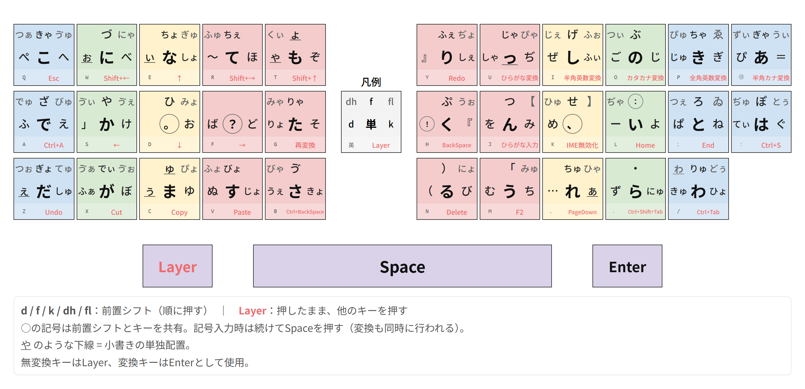

# りす配列 紹介ページ

keybor氏作「ぶな配列v2.0」に影響を受けた、前置シフト順次打鍵方式のかな入力配列です。

- 制作開始：2025年10月末
- 使用開始：2026年2月末

## 名前の由来

作者はぶな配列を約2年間愛用していました。「ぶな」の恩恵を受けて育った作者が作った配列なので、ぶなの森に暮らす動物から名前を取って「りす配列」としました。

## 配列図

## 仕組み

### 前置シフト順次打鍵

すべてのかなを、単打または前置シフトキーに続けて他のキーを打つ方式で入力します。シフトキーは **d, f, k, dh, fl** の5系統で、各モーラを1〜3ストロークで入力します。

濁音・半濁音・拗音・外来音も清音とは独立に配置し、ひとまとまりで入力します。

| ストローク数 | 例 |
| :-: | --- |
| 1打 | `m` →「う」、`x` →「が」 |
| 2打 | `fh` →「ぷ」、`kv` →「じょ」 |
| 3打 | `dhp` →「ぴゅ」、`fls` →「ゔぇ」 |

### キー共有（前置シフトと句読点の兼用）

前置シフトキーは句読点類と兼用しています。

| キー | シフト機能 | 句読点（+Space） |
| :-: | :-: | :-: |
| d | dシフト | 。 |
| k | kシフト | 、 |
| f | fシフト | ？ |
| dh | dhシフト | ！ |
| fl | flシフト | ： |

前置シフトキーの後に文字キーを押すとシフト先の文字を入力します。共有する記号を入力する場合はSpaceを押し、変換も同時に行われます。

## 設計の方針

- **配字は機械探索と手動判断の繰り返しで決定。** 固定する文字を段階的に増やしながら焼きなまし法を繰り返し、スコアを確認しつつ自分の指に馴染む配置に収束させました。
- **記号も通常のかなと同様に最適化の対象に。** 「」？！…・などの記号にも、かなと同じ枠組みで配置の最適化を行っています。
- **生成AIとの対話で頻出する語句の優遇。** 「ください」「生成」「あなた」など、作者が生成AIとの対話でよく使う語句が、自分にとって無理なく打てるよう意識して調整しました。
- **ぶな配列の運指の保存。** 実打で馴染みのあるぶな配列v2.0の運指をできるだけ活かしました。

## 評価関数とコーパスについて

rage2050氏の連接打鍵時間計測データと、同氏考案のボトルネックを考慮した計算モデルの考え方をもとに、3gram単位の擬似打鍵時間を算出し、コーパス全文を打ち切る総時間をスコアとしています。コーパスは、AIに、ブログ・創作・チャット・ビジネス文書など多様な文体の文章を生成させ、ひらがな換算で約7万字を独自に構築しました。

## 実装

かな入力部分はMozcのローマ字テーブルで実装しています。変換キーをEnterとして使用し、BackSpaceなどの機能キーは無変換キーとの組み合わせによるレイヤーとしてAutoHotkeyで実装しています。

## 機能レイヤー

無変換キーを押しながら文字キーを押すことで、機能キーやショートカットを入力します。次の方針で配置しています。

- 日本語入力に加え、基本的なPC操作も考慮する。
- 片手で操作したいキーを左手側に配置する。
- よく使うキーを中段に配置する。

## 謝辞

keybor様のぶな配列v2.0からは、入力方式や運指の一部を受け継ぎ、設計方法も参考にしました。

rage2050様の連接打鍵時間の計測データと、ボトルネックを考慮した計算モデルの考え方を配字の評価に用いました。

kouy様の100万字コーパス統計は、自作コーパスの検証や配字の参考にしました。

お名前を挙げた皆さまをはじめ、配列や入力環境に関する知見を共有してくださっている皆さまに感謝します。
